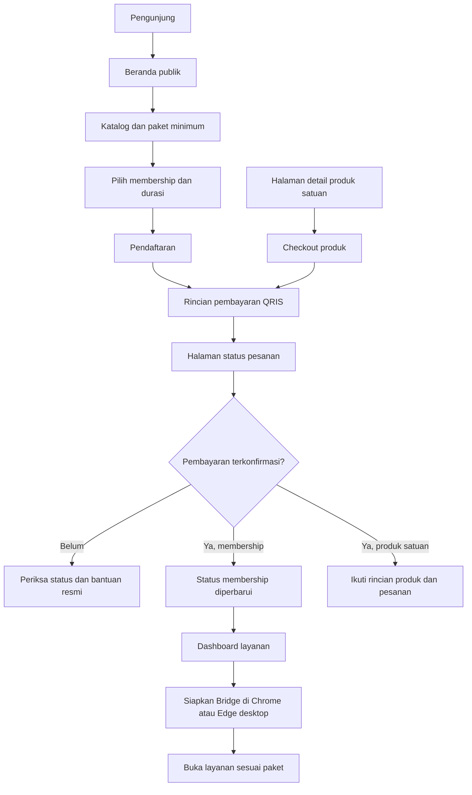

# FlowStore

**Katalog layanan digital, membership, dan dashboard akses dalam satu pengalaman.**

[Website FlowStore](https://flowstore.digital/)

FlowStore adalah storefront membership digital dengan dashboard untuk membuka layanan yang termasuk dalam paket pelanggan. Pengunjung dapat menelusuri kategori layanan, membandingkan paket dan durasi, kemudian melanjutkan ke pendaftaran serta pembayaran. Setelah pembayaran terkonfirmasi, dashboard menjadi titik awal penggunaan layanan melalui ekstensi browser FlowStore Bridge.

Studi kasus ini membahas hubungan antara katalog, keputusan pembelian, dan pengalaman setelah pembelian. Fokusnya adalah pengalaman pengguna yang dapat dijelaskan secara publik, bukan implementasi akses atau operasional layanan.

## Tampilan beranda

Cuplikan halaman publik tanpa login; tampilan produk dapat berubah.

## Tujuan dan kategori produk

FlowStore mempertemukan dua kebutuhan: calon pelanggan perlu memahami layanan yang ditawarkan sebelum membeli, sedangkan pelanggan perlu menemukan dan membuka layanan yang sesuai dengan membership mereka. Karena itu, beranda berfungsi sebagai etalase dan tempat membandingkan paket; dashboard berfungsi sebagai ruang penggunaan setelah pembelian.

Dalam studi kasus ini, kategori yang paling tepat adalah **storefront membership digital dan dashboard akses layanan**:

- **Bukan terutama LMS.** Edukasi merupakan salah satu kategori katalog, tetapi alur utama yang ditampilkan adalah memilih layanan, membeli akses, dan membukanya. Fokus pembahasan bukan pengelolaan kurikulum, tugas, penilaian, atau progres kelas.
- **Aplikasi web dengan model membership.** Istilah SaaS menjelaskan cara perangkat lunak disediakan sebagai layanan; untuk menjelaskan apa yang dijual FlowStore, istilah storefront membership lebih spesifik. Fungsi AI, desain, atau hiburan berasal dari layanan pihak ketiga, bukan otomatis fitur perangkat lunak yang dikembangkan FlowStore.
- **Lebih dari halaman promosi paket.** Pengalaman berlanjut ke status pesanan dan dashboard, sehingga informasi sebelum membeli perlu konsisten dengan akses yang dapat digunakan pelanggan.

Pembedaan ini menjelaskan ruang lingkup produk, bukan menyatakan bahwa seluruh layanan pihak ketiga dimiliki atau dikembangkan oleh FlowStore.

## Isi katalog dan fitur yang dihadapi pengguna

Beranda publik mengelompokkan layanan ke dalam kategori **AI & LLM, Streaming & Hiburan, Desain & Kreatif, Trading & Riset, Edukasi, Audio & Musik, serta Utilities**. Pengelompokan membantu pengunjung memulai dari kebutuhan, bukan harus mengetahui seluruh nama layanan terlebih dahulu.

| Bagian produk | Informasi atau tindakan pengguna | Perannya dalam alur |
| --- | --- | --- |
| Katalog layanan | Menelusuri kategori, mencari layanan, dan membaca label paket minimum | Memeriksa kecocokan layanan sebelum membeli |
| Perbandingan membership | Membandingkan Silver, Gold, Platinum, serta durasi yang ditampilkan | Memisahkan keputusan cakupan layanan dari lama berlangganan |
| Pendaftaran | Melanjutkan pilihan paket ke pembuatan akun FlowStore | Menghubungkan pilihan di beranda dengan langkah pembelian |
| Pembayaran dan pesanan | Membaca rincian tagihan, membayar melalui QRIS, dan memeriksa status | Membedakan pesanan yang dibuat dari pembayaran yang sudah terkonfirmasi |
| Dashboard layanan | Mencari dan memfilter layanan, melihat status Bridge, lalu membuka akses yang sesuai | Menjadi titik awal penggunaan setelah pembelian |
| Panduan dan bantuan | Membaca FAQ, mengikuti panduan Bridge, dan menghubungi kanal resmi | Menjelaskan kebutuhan perangkat dan tempat mencari bantuan |

Label Silver, Gold, dan Platinum pada katalog menunjukkan paket minimum untuk suatu layanan. FAQ publik menjelaskan bahwa Gold mencakup Silver, sedangkan Platinum mencakup Gold dan Silver. Hubungan cakupan ini membantu perbandingan paket, tetapi tidak menjadi janji bahwa setiap layanan akan selalu tersedia.

README ini tidak menyalin harga, jumlah layanan, stok, atau klaim ketersediaan dari halaman penjualan. Informasi tersebut dapat berubah dan perlu diperiksa langsung sebelum pembelian.

## Dua bentuk pembelian: membership dan produk satuan

**Membership** menjadi pintu masuk utama di beranda. Pengunjung memilih tingkat paket dan durasi berlangganan, lalu melanjutkan ke pendaftaran serta pembayaran. Nilai yang dibandingkan adalah cakupan layanan dalam paket dan masa berlakunya, bukan hanya nama satu produk.

**Produk satuan** tetap merupakan bagian dari alur penjualan yang didokumentasikan: terdapat halaman detail produk, checkout, dan halaman status pesanan. Jalur ini perlu dibedakan dari pembelian membership; rincian produk dan ketentuan pembelian mengikuti halaman produk yang bersangkutan.

Saat ditinjau, alamat `/shop` mengarah ke bagian harga membership di beranda. Perubahan pintu masuk tersebut tidak berarti bahwa seluruh alur produk satuan dihapus. Namun, keberadaan alur penjualan bukan bukti bahwa suatu produk sedang tersedia, dapat dibeli setiap saat, atau otomatis termasuk dalam semua paket.

## Perjalanan dari pengunjung menjadi pelanggan

Cabang membership mengikuti penjelasan pada halaman publik. Cabang produk satuan menggambarkan alur yang tercatat dalam dokumentasi sumber; ketersediaan produk dan hasil pembeliannya tidak diuji dalam studi kasus ini. Pembelian produk satuan tidak diasumsikan selalu berakhir pada akses membership melalui Bridge.

Pada jalur membership, pilihan paket dan durasi dibawa dari beranda ke pendaftaran. Membuat pesanan belum berarti membership aktif: pengguna perlu memeriksa status pembayaran. Setelah masuk ke tahap penggunaan, dashboard menjadi tujuan kunjungan berulang, dengan pencarian dan filter untuk menemukan layanan kembali.

Urutan ini menunjukkan pemisahan yang penting: **memilih produk, menyelesaikan transaksi, dan menggunakan akses adalah tahap berbeda**. Beranda tidak perlu menggantikan dashboard, dan dashboard tidak perlu mengulang seluruh materi penjualan.

## FlowStore Bridge dan batas penggunaan perangkat

FlowStore Bridge adalah ekstensi browser yang menghubungkan dashboard FlowStore dengan browser pengguna. Pada tingkat pengalaman pengguna, perannya adalah mendukung pembukaan layanan yang sesuai dengan paket dari dashboard.

- **Penggunaan Bridge memerlukan komputer dengan Chrome atau Edge**, sebagaimana dijelaskan pada halaman publik.
- **Ponsel dapat digunakan untuk melihat katalog dan memilih paket**, tetapi tidak diposisikan sebagai pengganti alur Bridge desktop.
- Pelanggan perlu mengikuti panduan instalasi resmi dan memastikan Bridge tersedia sebelum mencoba membuka layanan dari dashboard.
- Kebutuhan ekstensi merupakan bagian dari keputusan membeli, bukan detail yang baru disampaikan setelah transaksi.

Dokumentasi portofolio ini tidak membahas cara kerja akses di balik Bridge, tidak menyediakan salinan ekstensi, dan tidak memberikan petunjuk untuk melewati batas paket atau ketentuan layanan.

## Pertimbangan pengalaman pengguna

### Perbandingan sebelum komitmen

Beranda mengutamakan katalog dan pilihan paket sebelum meminta pengguna membuat akun. Kategori, pencarian, dan label paket minimum membantu menjawab pertanyaan yang konkret: apakah jenis layanan yang dicari ada dalam penawaran, dan paket mana yang perlu diperiksa lebih lanjut?

Durasi ditampilkan terpisah dari tingkat paket. Pemisahan ini membantu pembaca memahami bahwa cakupan layanan dan lama berlangganan merupakan dua keputusan berbeda. README tidak menetapkan rekomendasi paket tanpa mengetahui kebutuhan pengguna.

### Kondisi katalog yang tidak selalu ideal

Katalog membedakan pemuatan, hasil kosong, dan kegagalan pengambilan data. Ketiganya membawa arti berbeda: data belum siap, tidak ada hasil yang cocok, atau daftar tidak berhasil diperoleh. Menyatukannya menjadi tampilan kosong dapat membuat pengunjung salah menyimpulkan bahwa tidak ada layanan.

Dashboard mempertahankan daftar terakhir saat pembaruan latar belakang gagal dan menampilkan peringatan. Dengan demikian, kegagalan pembaruan tidak langsung menghilangkan konteks pencarian dan filter pengguna. Daftar lama tetap perlu dibaca bersama peringatan, bukan dianggap sebagai jaminan kondisi terbaru.

### Konsistensi dari etalase ke dashboard

Dokumentasi produk mencatat penggunaan tema terang dengan aksen tangerine pada beranda dan dashboard. Perbedaan fungsi tetap dijaga: beranda menjelaskan penawaran, sedangkan dashboard menempatkan katalog layanan dan tindakan penggunaan sebagai fokus. Pencarian dapat digabung dengan filter kategori untuk membantu pelanggan menemukan layanan kembali.

## Coba produknya

Lihat [flowstore.digital](https://flowstore.digital/) untuk katalog dan informasi paket saat ini. Ketersediaan layanan dapat berubah; konfirmasi di kanal resmi sebelum membeli. Penggunaan layanan pihak ketiga tunduk pada ketentuan masing-masing penyedia.

Untuk pembaruan layanan dan bantuan, gunakan [Discord resmi FlowStore](https://discord.gg/q7vkgk4Qcn) yang ditautkan dari website. Screenshot di atas hanya mewakili beranda publik, bukan bukti hasil transaksi atau pengujian akses seluruh layanan.

## Dasar penulisan dan batas klaim

Narasi disusun dari [beranda publik FlowStore](https://flowstore.digital/), bagian [katalog layanan](https://flowstore.digital/#layanan), [pilihan membership](https://flowstore.digital/#harga), FAQ publik, serta dokumentasi produk untuk alur storefront dan dashboard. Dokumentasi sumber digunakan untuk konteks fitur; berkas internalnya tidak disertakan dalam repositori ini.

Klasifikasi produk dan pelajaran desain di README merupakan analisis studi kasus. Deskripsi fitur bukan laporan pengujian transaksi, jaminan ketersediaan layanan, ukuran performa, ataupun klaim hasil bisnis. Harga, rincian paket, kompatibilitas terbaru, dan ketentuan pembelian harus dirujuk kembali ke kanal resmi.

## Tentang repositori ini

Repositori ini hanya berisi dokumentasi portofolio dan screenshot halaman publik. Source code aplikasi dan ekstensi, mekanisme akses, credential, sesi, konfigurasi deployment, data pelanggan, dan riwayat pengembangan internal tidak dipublikasikan. Tidak ada instruksi menjalankan aplikasi dari repositori ini.

© 2026 FlowStore. All rights reserved.
