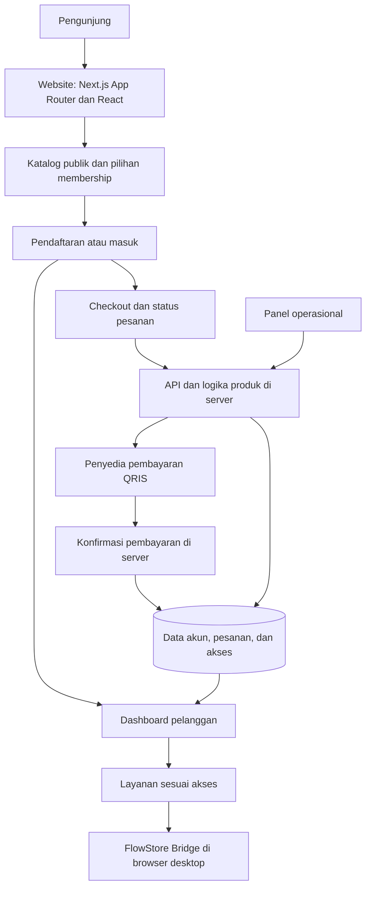

# FlowStore

**Dari memilih layanan digital sampai kembali menggunakannya.**

FlowStore adalah etalase membership digital dengan katalog, pilihan paket, dan dashboard layanan. Pengunjung membandingkan cakupan serta durasi sebelum membeli; pelanggan kembali ke dashboard untuk membuka layanan yang termasuk dalam paketnya.

Saya membangun FlowStore sebagai **Founder & Solo Developer**, dari struktur penawaran dan antarmuka publik hingga alur akun, pembelian, dan pengalaman dashboard.

[Lihat website](https://flowstore.digital/) · [Telusuri katalog](https://flowstore.digital/#layanan) · [Bandingkan membership](https://flowstore.digital/#harga)

*Screenshot beranda publik tanpa login. Panel “Ruang layananmu” merupakan preview katalog, bukan dashboard pelanggan.*

## Masalah produk

Banyaknya layanan belum menjawab dua pertanyaan dasar: **paket mana yang sesuai, dan dari mana layanan itu digunakan setelah membeli?** Kategori, tingkat membership, durasi, serta kebutuhan perangkat menjawab hal yang berbeda. Menumpuk semuanya sebagai daftar manfaat akan menyulitkan pembaca membedakan pilihan tersebut.

Saya memisahkan pengalaman menjadi penelusuran katalog, perbandingan membership, lalu penggunaan melalui dashboard. Katalog menyediakan kategori dan pencarian; label paket minimum menghubungkan layanan dengan Silver, Gold, atau Platinum. Pilihan durasi ditempatkan terpisah agar periode penggunaan tidak tertukar dengan cakupan paket.

Ada batas perangkat yang penting: katalog dapat dibaca dari ponsel, sedangkan penggunaan FlowStore Bridge dijelaskan untuk Chrome atau Edge di komputer. Prasyarat ini muncul di beranda dan FAQ, sebelum pengunjung berkomitmen membeli.

## Tampilan produk

Tiga screenshot berikut direkam dari website publik pada **7 November 2026**, melalui browser terisolasi tanpa login atau pembelian. Isi tampilan dipertahankan; gambar membership menggunakan potongan bagian atas. Harga, jumlah layanan, dan teks penawaran merekam kondisi halaman saat pengambilan, bukan ukuran dampak produk atau jaminan ketersediaan saat ini.

### Katalog desktop

Kategori menjadi titik masuk bagi pengunjung yang belum mengetahui nama layanan; pencarian melayani tujuan yang lebih spesifik. Nama layanan dan label paket berada dalam baris ringkas agar keduanya dapat dibaca bersama. Screenshot pada bagian `#layanan`, viewport **1440 × 1000 CSS px**, menampilkan sebagian daftar.

### Cakupan dan durasi membership

Silver, Gold, dan Platinum dibandingkan berdampingan, dengan pilihan 30, 90, dan 180 hari di atasnya. FAQ menjelaskan bahwa Gold mencakup Silver, sedangkan Platinum mencakup keduanya. Screenshot pada lebar **1440 CSS px** memperlihatkan pilihan awal satu bulan; **rincian manfaat di bawah kartu tidak termasuk dalam crop**.

### Katalog mobile

Pada viewport **390 × 844 CSS px**, kategori membungkus ke beberapa baris dan daftar berubah menjadi satu kolom. Pencarian serta label paket tetap hadir. Ini adalah tampilan etalase mobile, bukan penggunaan Bridge di ponsel.

## Di balik FlowStore: rancangan produk dan sistem

Sebagai **Founder & Solo Developer**, saya mengerjakan etalase, akun pelanggan, pembelian, dashboard, dan alat operasional. Peta ini menjelaskan pembagian tanggung jawab pada tingkat produk, bukan cara mengakses layanan atau konfigurasi internalnya. Repositori showcase tetap hanya berisi dokumentasi dan gambar publik.

### Fitur dan tanggung jawabnya

| Area | Yang saya bangun | Alur pengguna dan sistem |
| --- | --- | --- |
| **Etalase** | Beranda, katalog berkategori dengan pencarian, perbandingan Silver/Gold/Platinum, pilihan durasi, dan FAQ. | Pengunjung menilai cakupan dan prasyarat perangkat sebelum memilih paket. |
| **Akun** | Pendaftaran, masuk dengan email atau Discord, dan halaman akun. | Identitas pelanggan dan status membership dipisahkan; membuat akun saja tidak membuka paket berbayar. |
| **Pembelian** | Checkout QRIS, halaman status pesanan, dan jalur pembaruan layanan tertentu. | Pilihan paket dibawa ke pembelian; konfirmasi pembayaran diproses di server sebelum status pesanan dan akses diperbarui. |
| **Dashboard** | Ringkasan akun, katalog layanan sesuai tingkat akses, pencarian, dan peluncuran melalui FlowStore Bridge di browser desktop. | Pelanggan masuk untuk melihat layanan yang tersedia bagi akunnya; Bridge membantu membuka layanan dari browser yang didukung. |
| **Operasional** | Panel untuk meninjau pesanan, pelanggan, lisensi, katalog, dan antrean pengiriman. | Pengelolaan layanan dan pemeriksaan pesanan berada di area operasional, terpisah dari etalase pelanggan. |

### Peta sistem

**Stack:** Next.js 14, React 18, TypeScript, Tailwind CSS, Supabase untuk data PostgreSQL, dan integrasi pembayaran QRIS. FlowStore Bridge adalah ekstensi browser untuk pengalaman membuka layanan dari dashboard; Discord juga tersedia sebagai pilihan masuk. Daftar ini menggambarkan komponen produk yang terlihat dari implementasi, bukan inventaris konfigurasi deployment.

### Bagaimana alur utamanya bekerja

**Dari katalog ke akun.** Katalog publik menampilkan layanan dan tingkat paket minimum. Pengunjung memilih tingkat membership serta durasi, lalu melanjutkan ke pendaftaran atau masuk tanpa kehilangan pilihan. Identitas akun dibuat terpisah dari hak membership; pemilik akun baru belum otomatis menjadi pelanggan paket berbayar.

**Dari pesanan ke akses.** Checkout menyiapkan pesanan dan pembayaran QRIS. Halaman status membantu pembeli mengikuti prosesnya; pembaruan akses bergantung pada pembayaran yang dikonfirmasi di server, bukan sekadar layar checkout yang terbuka. Produk atau layanan dengan alur pembaruan tersendiri tidak disamakan dengan pembelian membership baru. Ketersediaan, harga, serta ketentuan mengikuti website saat transaksi.

**Dari dashboard ke layanan.** Setelah masuk, pelanggan melihat status akun dan layanan berdasarkan aksesnya. Pada browser desktop yang didukung, FlowStore Bridge menghubungkan tindakan membuka layanan dari dashboard dengan pengalaman browser. Dashboard dan panel operasional mempunyai tujuan berbeda: yang pertama untuk pelanggan, yang kedua untuk pengelolaan katalog, pesanan, dan layanan.

Uraian arsitektur ini berasal dari peninjauan implementasi privat; tidak ada pengujian transaksi, akun pelanggan, atau sistem pembayaran produksi untuk studi kasus ini. Mekanisme akses, detail integrasi, data pelanggan, dan kredensial tidak dipublikasikan.

## Keputusan pengembangan

### Pilihan pengguna tidak berhenti di halaman harga

Paket dan durasi yang dipilih tetap dibawa ke pendaftaran; ketika pengguna perlu masuk, tujuan pembelian dipertahankan. Saya membedakan pembuatan akun dari aktivasi membership: halaman publik menjelaskan bahwa status langganan diperbarui setelah pembayaran terkonfirmasi, bukan ketika formulir pendaftaran selesai.

Keputusan ini menjaga kesinambungan antara membandingkan, memilih, dan melanjutkan pembelian tanpa menyamakan tahap-tahap tersebut.

### Pembaruan dashboard tidak mengosongkan pekerjaan pengguna

Pemuatan pertama dan pembaruan berikutnya diperlakukan berbeda. Setelah daftar tersedia, pencarian, filter, dan kartu tetap tampil selama pembaruan latar belakang. Jika pembaruan gagal, dashboard mempertahankan data terakhir dengan peringatan; respons berhasil yang memang kosong tetap menghapus daftar lama.

Trade-off-nya jelas: data terakhir belum tentu terbaru. Mempertahankan konteks harus disertai penanda kegagalan, bukan menyembunyikannya. Pada katalog publik, keadaan memuat, gagal dengan opsi mencoba lagi, dan hasil kosong juga dibedakan.

### Konsistensi mencakup perilaku, bukan hanya warna

Palet terang, teks charcoal, dan aksen tangerine menyatukan beranda dengan halaman pelanggan. Katalog memakai baris ringkas untuk penelusuran, sementara kartu membership dipakai untuk perbandingan paket.

Menu mobile dapat ditutup dengan Escape dan mengembalikan fokus ke pemicunya. FAQ menggunakan kontrol buka-tutup bawaan HTML, dan preferensi pengurangan gerakan dihormati. Tujuannya mempertahankan pola interaksi saat pengguna berpindah halaman atau perangkat, bukan hanya menyamakan tampilan screenshot.

## Saat ini

[Website FlowStore](https://flowstore.digital/) menampilkan katalog, perbandingan paket, panduan penggunaan, dan pintu masuk akun. Setelah pembayaran terkonfirmasi, pelanggan menggunakan dashboard untuk membuka layanan sesuai paket melalui Bridge di browser desktop. Detail penawaran dan ketersediaan layanan mengikuti website saat digunakan.

Perilaku dashboard dan interaksi keyboard di atas dijelaskan berdasarkan dokumentasi pengembangan; screenshot dalam repo ini hanya menampilkan halaman publik. Tidak ada transaksi atau akses dashboard pelanggan yang dilakukan untuk studi kasus ini.

Repositori ini memuat studi kasus dan gambar halaman publik, bukan source aplikasi. Kode, mekanisme internal, kredensial, dan data pelanggan tetap privat.

## Referensi

- [Beranda dan katalog](https://flowstore.digital/) serta [FAQ](https://flowstore.digital/#faq): kategori, paket minimum, cakupan membership, dan persyaratan perangkat.
- [Dari Akun ke Layanan](https://flowstore.digital/#cara-kerja): urutan penggunaan yang dijelaskan produk.
- [Pendaftaran](https://flowstore.digital/register) dan [halaman masuk](https://flowstore.digital/login): pintu masuk pengguna baru dan pelanggan kembali.
- [Syarat & Ketentuan](https://flowstore.digital/terms) dan [Kebijakan Privasi](https://flowstore.digital/privacy): acuan pembelian dan penggunaan data yang berlaku di website.
- [Discord resmi FlowStore](https://discord.gg/q7vkgk4Qcn): kanal bantuan dan pembaruan yang ditautkan website.

© 2026 FlowStore. All rights reserved.
