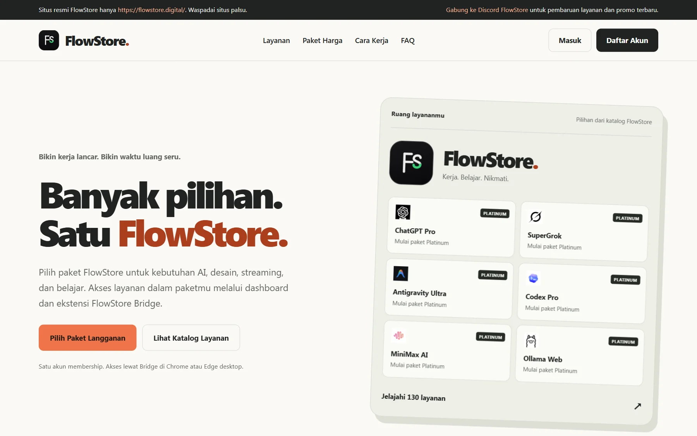
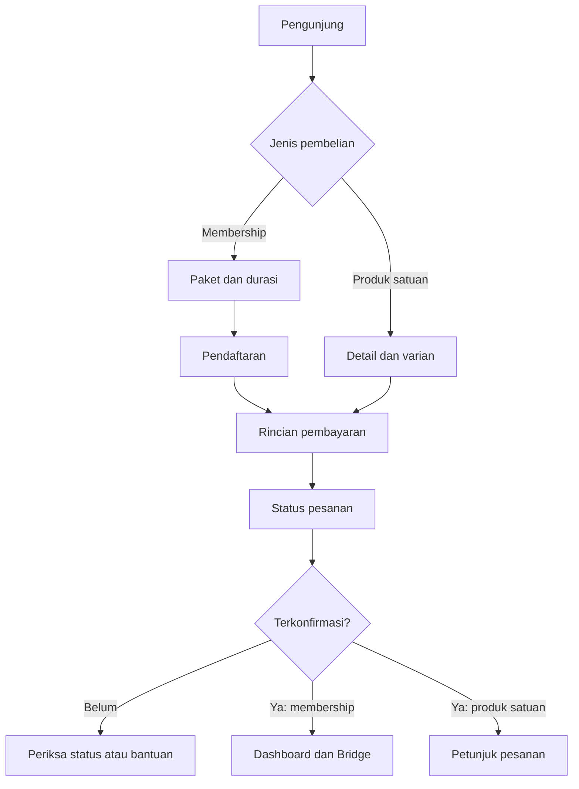

# FlowStore

**Katalog layanan digital, membership, dan dashboard akses dalam satu pengalaman.**

[Website FlowStore](https://flowstore.digital/) · [Katalog layanan](https://flowstore.digital/#layanan) · [Pilihan membership](https://flowstore.digital/#harga)

## Kontribusi pengembangan saya

**Saya mengembangkan pengalaman web FlowStore dari penelusuran katalog dan pemilihan membership sampai penggunaan dashboard.** Fokus pekerjaan saya bukan hanya menampilkan paket, tetapi menjaga kelanjutan pilihan pengguna, menjelaskan keadaan aplikasi, dan membuat antarmuka tetap dapat digunakan saat data belum siap atau pembaruan gagal.

Bagian ini merangkum pekerjaan pada project milik saya; bukan klaim bahwa seluruh kode ditulis seorang diri. Detail implementasi dan mekanisme akses tetap privat. Hasil yang dijelaskan adalah keluaran pekerjaan, bukan klaim kenaikan penjualan atau jumlah pelanggan.

### Apa yang saya bangun dan kerjakan

| Area pekerjaan | Kontribusi konkret | Hasil yang dapat dijelaskan |
| --- | --- | --- |
| Etalase membership | Menata katalog, pencarian, kategori, perbandingan tingkat paket, durasi, dan FAQ dalam satu perjalanan | Pengunjung dapat memeriksa kebutuhan sebelum memulai pendaftaran |
| Kelanjutan pembelian | Menjaga pilihan tingkat paket dan durasi saat berpindah ke pendaftaran, serta tujuan pembelian ketika perlu masuk | Perpindahan halaman tidak memutus konteks pilihan yang sudah dibuat |
| Keadaan katalog | Membedakan pemuatan, kegagalan dengan percobaan ulang, dan hasil kosong | Gangguan pengambilan data tidak ditampilkan seolah-olah tidak ada layanan |
| Dashboard | Mengembangkan pencarian dan filter serta pengalaman pembaruan tanpa mengosongkan tampilan yang sudah tersedia | Pengguna tetap mempunyai konteks ketika pembaruan latar belakang gagal, disertai peringatan |
| Konsistensi antarmuka pelanggan | Menyatukan tema dan pola tampilan pada halaman pelanggan | Pengalaman beranda, akun, dan pembelian tidak terasa sebagai halaman yang berdiri sendiri |
| Interaksi responsif | Menangani menu mobile, penutupan dengan Escape, pengembalian fokus, FAQ, dan preferensi pengurangan gerakan | Interaksi tidak hanya dirancang untuk klik mouse di desktop |

### Kasus engineering yang bisa saya jelaskan saat wawancara

**1. Menjaga konteks dari pemilihan paket sampai pendaftaran.**

- **Masalah:** pengguna sudah menentukan paket dan durasi; perpindahan ke pendaftaran atau masuk berpotensi membuat pilihan itu terasa hilang.
- **Keputusan saya:** mempertahankan konteks pilihan sepanjang perpindahan halaman yang terkait, sambil tetap membedakan proses membuat akun dari konfirmasi pembelian.
- **Hasil pekerjaan:** pilihan di etalase tetap relevan pada langkah berikutnya. Membuat akun tidak ditampilkan sebagai bukti bahwa membership sudah aktif.
- **Trade-off:** alur perlu menangani pengguna baru dan pengguna yang kembali tanpa menganggap keduanya mulai dari halaman yang sama.

**2. Menangani katalog dan dashboard saat pembaruan tidak berhasil.**

- **Masalah:** mengosongkan seluruh tampilan saat setiap pembaruan membuat pengguna kehilangan konteks dan dapat menyangka layanan sudah tidak tersedia.
- **Keputusan saya:** membedakan pemuatan pertama dari pembaruan berikutnya; mempertahankan daftar terakhir saat pembaruan gagal dan memperlihatkan peringatan.
- **Hasil pekerjaan:** pencarian dan filter tetap mempunyai konteks selama gangguan pembaruan. Respons kosong yang berhasil tetap dibedakan dari kegagalan memperoleh data.
- **Trade-off:** data terakhir belum tentu kondisi terbaru. Peringatan tetap diperlukan; mempertahankan tampilan bukan alasan menyembunyikan kegagalan.

**3. Membuat konsistensi visual tanpa mengabaikan interaksi.**

- **Masalah:** tema yang sama tidak cukup jika menu mobile, fokus keyboard, atau gerakan masih menghambat penggunaan.
- **Keputusan saya:** menyatukan pola visual pelanggan sekaligus menangani Escape, pengembalian fokus menu, disclosure FAQ, dan preferensi reduced motion.
- **Hasil pekerjaan:** desain mencakup perilaku kontrol, bukan hanya warna dan screenshot halaman utama.
- **Trade-off:** animasi digunakan sebagai umpan balik terbatas; interaksi utama tidak bergantung pada animasi terus-menerus. Ini bukan klaim sertifikasi aksesibilitas menyeluruh.

### Kualitas dan batas bukti

Dokumentasi pengembangan mencatat pemeriksaan build, tipe, regresi alur akun dan pembelian, serta pengamatan browser pada tampilan mobile dan desktop. Area yang perlu dijaga meliputi kelanjutan pilihan paket, fokus keyboard, overflow horizontal, dan pemisahan keadaan pemuatan/kegagalan. **Pemeriksaan pengembangan tersebut tidak diklaim dijalankan ulang saat pembaruan README ini.**

Perilaku dashboard di atas bersumber dari catatan pengembangan; tidak dipresentasikan sebagai hasil pengujian akun pelanggan dalam showcase. Tidak ada transaksi nyata, data pelanggan, atau mekanisme akses yang dipublikasikan. Keberadaan penanganan suatu kasus juga bukan jaminan bahwa produk tidak memiliki bug.

### Panduan peninjauan untuk recruiter

1. Buka [beranda](https://flowstore.digital/) dan telusuri hubungan antara katalog, pilihan paket, durasi, dan FAQ.
2. Gunakan pencarian atau kategori untuk menilai bagaimana pengunjung mempersempit kebutuhan. Jangan menyamakan label paket dengan jaminan ketersediaan layanan.
3. Bandingkan tampilan desktop dan ponsel, lalu coba navigasi keyboard pada kontrol publik. Ini merupakan panduan peninjauan, bukan klaim seluruh kombinasi perangkat sudah diuji.
4. Diskusikan kasus engineering di atas: apa yang perlu dipertahankan saat pengguna berpindah halaman, bagaimana membedakan data kosong dan kegagalan, serta kapan data terakhir masih layak ditampilkan. Tidak perlu membuat pesanan untuk meninjau etalase.

**Kompetensi yang ditunjukkan melalui pekerjaan:** pengembangan antarmuka produk komersial, penanganan state asinkron, kelanjutan alur pengguna, desain responsif, interaksi keyboard, konsistensi komponen, dan pemeriksaan regresi. Penilaian tidak didasarkan pada angka omzet atau performa yang tidak dibuktikan.

## Gambaran produk

FlowStore adalah storefront membership digital dengan dashboard untuk membuka layanan yang termasuk dalam paket pelanggan. Pengunjung dapat menelusuri kategori, membandingkan paket dan durasi, kemudian melanjutkan ke pendaftaran serta pembayaran. Halaman publik menjelaskan bahwa status langganan diperbarui setelah pembayaran terkonfirmasi; penggunaan layanan membership berlanjut melalui dashboard dan ekstensi FlowStore Bridge. [1][2]

Studi kasus ini membahas keputusan pengguna sebelum membeli, perbedaan status selama pembelian, dan kebutuhan saat kembali menggunakan layanan. Pembahasannya terbatas pada pengalaman produk, bukan implementasi aplikasi atau mekanisme akses.

## Daftar isi

- [Kontribusi pengembangan saya](#kontribusi-pengembangan-saya)
- [Kasus engineering](#kasus-engineering-yang-bisa-saya-jelaskan-saat-wawancara)
- [Kualitas dan batas bukti](#kualitas-dan-batas-bukti)
- [Panduan peninjauan untuk recruiter](#panduan-peninjauan-untuk-recruiter)
- [Tampilan beranda](#tampilan-beranda)
- [Posisi produk dan masalah pengguna](#posisi-produk-dan-masalah-pengguna)
- [Membaca kategori dari kebutuhan](#membaca-kategori-dari-kebutuhan)
- [Membedakan paket, durasi, dan ketersediaan](#membedakan-paket-durasi-dan-ketersediaan)
- [Contoh keputusan yang bersifat ilustratif](#contoh-keputusan-yang-bersifat-ilustratif)
- [Tanggung jawab setiap bagian produk](#tanggung-jawab-setiap-bagian-produk)
- [Membership, produk satuan, dan perpanjangan](#membership-produk-satuan-dan-perpanjangan)
- [Peta perjalanan pembelian dan penggunaan](#peta-perjalanan-pembelian-dan-penggunaan)
- [Memahami status pembelian dan akses](#memahami-status-pembelian-dan-akses)
- [Pelanggan pertama dan pelanggan kembali](#pelanggan-pertama-dan-pelanggan-kembali)
- [Bridge, perangkat, dan bantuan](#bridge-perangkat-dan-bantuan)
- [Pertimbangan pengalaman pengguna](#pertimbangan-pengalaman-pengguna)
- [Ruang lingkup dan batas kesimpulan](#ruang-lingkup-dan-batas-kesimpulan)
- [Referensi publik](#referensi-publik)
- [Tentang repositori ini](#tentang-repositori-ini)

## Tampilan beranda

Cuplikan beranda publik tanpa login. Screenshot dipertahankan sebagai konteks visual, bukan katalog terkini atau bukti keberhasilan pembelian.

## Posisi produk dan masalah pengguna

FlowStore mempertemukan dua kebutuhan yang berbeda: memahami penawaran sebelum membeli dan menemukan layanan yang dapat digunakan setelah membeli. Beranda menjelaskan pilihan; dashboard menjadi titik awal penggunaan membership yang dijelaskan pada website. [1][2]

Kategori produk yang paling tepat dalam studi kasus ini adalah **storefront membership digital dan dashboard akses layanan**.

- **Bukan terutama LMS.** Edukasi merupakan kategori katalog, tetapi alur publik berpusat pada pemilihan paket, pembayaran, dan pembukaan layanan. Halaman yang ditinjau tidak menjadi dasar untuk mengklaim pengelolaan kelas, penilaian, atau progres belajar.
- **Aplikasi web dengan model membership.** Istilah ini menjelaskan apa yang dibandingkan dan dibeli pengguna dengan lebih spesifik daripada sekadar menyebutnya SaaS.
- **Bukan kumpulan fungsi pihak ketiga yang dikembangkan sendiri.** Fungsi AI, desain, atau hiburan berada pada layanan yang ditawarkan melalui katalog. Footer website menyatakan tidak ada afiliasi resmi dengan merek pihak ketiga yang ditampilkan. [1]
- **Lebih dari halaman promosi.** Penjelasan publik berlanjut sampai status pembayaran, dashboard, kebutuhan Bridge, dan bantuan. [2][3]

Dari sudut pandang pengguna, keputusan utamanya dapat dirumuskan sebagai berikut:

| Kebutuhan | Pertanyaan yang perlu terjawab | Bagian yang perlu dibaca |
| --- | --- | --- |
| Menemukan layanan yang relevan | Apakah kategori yang saya butuhkan ada dalam penawaran? | Katalog dan pencarian |
| Memilih cakupan | Paket minimum apa yang ditandai untuk layanan tersebut? | Label katalog dan FAQ |
| Menentukan komitmen waktu | Berapa lama saya memerlukan akses? | Pilihan durasi |
| Memastikan kesiapan | Apakah perangkat saya sesuai untuk penggunaan Bridge? | FAQ perangkat |
| Memahami pembelian | Apa yang saya beli dan bagaimana mengetahui statusnya? | Rincian pembelian dan ketentuan |
| Menggunakan kembali | Dari mana saya membuka layanan atau meminta bantuan? | Dashboard dan kanal resmi |

Tabel ini adalah kerangka membaca produk, bukan hasil wawancara pelanggan atau pengukuran perilaku pengguna.

## Membaca kategori dari kebutuhan

Beranda menampilkan tujuh kategori berikut. Pemetaan kebutuhan di bawah merupakan interpretasi untuk membantu pembaca menavigasi katalog, bukan janji bahwa fungsi atau produk tertentu selalu tersedia. [1]

| Kategori publik | Kebutuhan yang dapat menjadi titik awal pencarian | Hal yang perlu diperiksa lebih lanjut |
| --- | --- | --- |
| AI & LLM | Menulis draf, mencari bantuan ide, atau menelaah informasi | Layanan yang tercantum, paket minimum, dan batas penggunaan yang berlaku |
| Streaming & Hiburan | Mencari layanan untuk waktu luang | Penawaran aktual dan ketentuan perangkat atau wilayah pada layanan terkait |
| Desain & Kreatif | Menyiapkan materi visual atau kebutuhan produksi konten | Cakupan fitur serta ketentuan penggunaan aset pada layanan yang dipilih |
| Trading & Riset | Mencari alat analisis atau bahan riset | Jenis produk, varian, dan ketentuan penggunaannya; bukan janji hasil investasi |
| Edukasi | Menemukan layanan untuk belajar mandiri | Materi atau fitur yang benar-benar tersedia pada layanan terkait |
| Audio & Musik | Menelusuri kebutuhan mendengarkan atau bekerja dengan audio | Fungsi layanan dan hak penggunaan kontennya |
| Utilities | Mencari bantuan untuk pekerjaan dokumen atau tugas pendukung | Kesesuaian fungsi dengan pekerjaan yang ingin diselesaikan |

Kategori berguna ketika pengunjung belum mengetahui nama layanan. Pencarian nama lebih relevan ketika ia sudah memiliki tujuan tertentu. Keduanya membantu mempersempit pilihan, tetapi tidak menggantikan pemeriksaan rincian paket. [1][3]

Nama kategori juga tidak menentukan hak penggunaan komersial, fitur spesifik, atau hasil pekerjaan. Detail tersebut perlu dibaca pada penawaran dan ketentuan layanan terkait, bukan disimpulkan dari label kategori.

## Membedakan paket, durasi, dan ketersediaan

Tiga hal ini menjawab pertanyaan yang berbeda dan tidak seharusnya disatukan menjadi satu penilaian “paket terbaik”.

| Dimensi | Pertanyaan pengguna | Dasar publik | Bukan berarti |
| --- | --- | --- | --- |
| Tingkat paket | Layanan mana yang termasuk cakupan saya? | Silver, Gold, Platinum; label katalog menunjukkan paket minimum | Semua kategori otomatis memiliki cakupan yang sama |
| Durasi | Berapa lama periode yang dipilih? | Pilihan 30, 90, dan 180 hari pada beranda | Durasi lebih panjang otomatis menaikkan tingkat paket |
| Ketersediaan | Apakah layanan yang dibutuhkan dapat ditawarkan saat ini? | FAQ meminta konfirmasi melalui kanal resmi bila katalog tidak termuat | Label paket adalah janji ketersediaan terus-menerus |

FAQ menjelaskan bahwa **Gold mencakup Silver**, sedangkan **Platinum mencakup Gold dan Silver**. Hubungan ini menjelaskan urutan cakupan, bukan kewajiban semua pengguna untuk memilih tingkat tertinggi. [3]

Pilihan durasi ditampilkan terpisah dari tingkat membership. Untuk membaca penawaran, tentukan terlebih dahulu cakupan yang sesuai, lalu pertimbangkan periode penggunaan dan rincian pembayaran yang tampil. [1]

Label paket minimum tidak cukup untuk memastikan kecocokan seluruh kebutuhan. Periksa layanan yang dimaksud, persyaratan perangkat, dan aturan pemakaian sebelum menjadikan harga sebagai satu-satunya pertimbangan. [3][4]

Harga, jumlah layanan, stok, serta klaim jaminan tidak disalin ke README ini. Acuan pembelian tetap halaman resmi yang berlaku ketika pengguna membuat keputusan.

## Contoh keputusan yang bersifat ilustratif

**Seluruh contoh berikut adalah skenario hipotetis**, bukan pelanggan yang diamati, testimoni, atau hasil penggunaan FlowStore. Nama produk tertentu sengaja tidak dijadikan rekomendasi tetap.

### Menyiapkan materi belajar dan presentasi

Seorang pembaca membutuhkan bantuan menulis, membuat visual, dan mengolah dokumen untuk proyek singkat.

1. Mulai dari kategori AI & LLM, Desain & Kreatif, serta Utilities.
2. Cari layanan yang benar-benar sesuai dengan jenis pekerjaan tersebut.
3. Bandingkan label paket minimum pada layanan yang dibutuhkan, bukan pada seluruh katalog.
4. Pilih durasi setelah mempertimbangkan jadwal proyek dan ketentuan pembelian.

Pelajarannya: beberapa kategori dapat relevan untuk satu pekerjaan, tetapi banyaknya kategori tidak dengan sendirinya menentukan tingkat membership.

### Mengutamakan satu alat riset

Seorang pembaca hanya mencari satu alat untuk kegiatan riset rutin, bukan akses ke banyak kategori.

Ia perlu membedakan penawaran membership dengan detail produk satuan apabila produk yang dicari memang ditawarkan melalui jalur tersebut. Nama layanan yang mirip tidak membuktikan bahwa cakupan, varian, durasi, dan hasil pembeliannya identik. Ketentuan publik menyatakan bahwa rincian produk dan varian perlu dibaca sebelum checkout. [4]

Pelajarannya: bandingkan **apa yang dibeli**, bukan hanya nama merek atau angka harga. Tidak ada kesimpulan bahwa produk satuan pasti lebih murah atau lebih tepat.

### Menelusuri katalog dari ponsel

Seorang pembaca menemukan paket yang menarik saat menggunakan ponsel, tetapi ingin menggunakan layanan melalui laptop.

Ia dapat membaca katalog dan memilih paket dari ponsel. Sebelum berkomitmen, ia perlu memastikan komputer dengan Chrome atau Edge tersedia untuk penggunaan Bridge sebagaimana dijelaskan FAQ. Bila hanya memiliki ponsel, konfirmasikan kesesuaian kebutuhan sebelum membeli. [3]

Pelajarannya: kemampuan membuka halaman penjualan tidak sama dengan kesiapan menjalankan alur penggunaan membership.

## Tanggung jawab setiap bagian produk

“Bagian” di sini berarti area yang dihadapi pengguna, bukan modul source code atau gambaran arsitektur aplikasi.

| Bagian | Tanggung jawab bagi pengguna | Batasnya dalam perjalanan |
| --- | --- | --- |
| Beranda | Menjelaskan penawaran dan menyediakan pintu masuk ke katalog, harga, serta FAQ | Bukan bukti bahwa suatu pembelian sudah selesai |
| Katalog | Membantu mencari kategori dan membaca paket minimum | Tidak menggantikan konfirmasi ketersediaan terbaru |
| Pilihan membership | Memisahkan keputusan tingkat paket dari durasi | Tidak menjelaskan semua ketentuan produk satuan |
| Pendaftaran dan masuk | Menyediakan jalur awal bagi pengguna baru dan pintu kembali bagi pelanggan | Membuat akun tidak sama dengan mengaktifkan langganan |
| Rincian pembelian | Memberi konteks produk, varian, periode, dan pembayaran sebelum komitmen | Informasi harus dibaca untuk pilihan yang sedang dibeli |
| Halaman pesanan | Menjadi tempat memeriksa status pembayaran dan petunjuk berikutnya | Status pembayaran tidak boleh ditebak dari tindakan pengguna saja |
| Dashboard | Menjadi titik awal membuka layanan membership sesuai paket | Tidak menggantikan fungsi utama layanan pihak ketiga |
| FlowStore Bridge | Mendukung pembukaan layanan dari dashboard di browser yang disebutkan | Bukan aplikasi seluler atau janji kompatibilitas semua browser |
| FAQ dan bantuan | Menjelaskan prasyarat, pembaruan layanan, dan langkah saat ada kendala | Tidak menggantikan rincian ketentuan pembelian |

Pembagian tanggung jawab tersebut merangkum penjelasan beranda, FAQ, halaman masuk, dan ketentuan publik. [1][2][3][4][6][7]

## Membership, produk satuan, dan perpanjangan

### Membership

Membership adalah penawaran utama di beranda: pengguna memilih tingkat paket dan durasi, membuat akun, menyelesaikan pembayaran, lalu membuka layanan yang termasuk paket melalui dashboard dan Bridge. Status langganan diperbarui setelah pembayaran terkonfirmasi. [1][2]

Objek perbandingannya adalah **cakupan layanan dan periode membership**. Adanya nama layanan dalam materi penawaran tidak membuat semua pilihan atau varian produk terkait otomatis setara.

### Produk satuan

Halaman Syarat & Ketentuan juga membahas pembelian produk dan varian, serta menautkan halaman produk individual. Itu menjadi dasar publik untuk membedakan jalur produk satuan dari membership. [4]

Untuk jalur ini, baca nama produk, varian, durasi, petunjuk pemenuhan, dan batas penggunaan yang ditampilkan. Jangan menganggap setiap pembelian produk satuan akan mengaktifkan membership atau selalu digunakan melalui dashboard dengan alur yang sama.

Halaman produk tertaut yang dibaca secara statis hanya menampilkan keadaan “Memuat produk”. Karena itu, README tidak menetapkan varian yang tersedia, harga, atau hasil pembelian produk satuan berdasarkan halaman tersebut.

### Perpanjangan

Pilihan durasi pada beranda adalah bukti adanya beberapa periode pembelian, **bukan bukti perpanjangan otomatis**. Materi publik yang ditinjau tidak cukup untuk menjelaskan aturan penambahan masa aktif, penggabungan sisa periode, atau perubahan tingkat paket saat memperpanjang.

Bagi pelanggan yang ingin melanjutkan penggunaan, pertanyaan praktisnya adalah periode mana yang berlaku, kapan periode baru dimulai, dan apakah pilihan yang tersedia tetap sesuai kebutuhan. Konfirmasikan rincian tersebut melalui kanal resmi sebelum membuat komitmen baru. README ini tidak menetapkan prosedur perpanjangan yang belum dibuktikan.

## Peta perjalanan pembelian dan penggunaan

Diagram merangkum alur yang dijelaskan pada halaman publik, bukan rekaman transaksi yang dijalankan. Dua keluaran sengaja dipisahkan: membership berlanjut ke penggunaan dashboard, sedangkan produk satuan mengikuti rincian pesanannya. [2][4]

## Memahami status pembelian dan akses

Istilah di tabel ini adalah deskripsi bagi pembaca, bukan daftar label status resmi yang dipastikan muncul persis sama di antarmuka.

| Keadaan | Arti bagi pengguna | Langkah yang relevan |
| --- | --- | --- |
| Masih membandingkan | Belum ada komitmen pembelian | Periksa kebutuhan, cakupan, durasi, dan perangkat |
| Membaca atau mengisi checkout | Membuka formulir saja belum membuat pesanan menurut ketentuan | Periksa kembali pilihan dan data sebelum melanjutkan |
| Pesanan menunggu pembayaran | Ada langkah pembayaran yang perlu diselesaikan | Ikuti rincian yang tampil dan perhatikan batas waktunya |
| Sudah membayar, belum melihat konfirmasi | Tindakan membayar dan status terkonfirmasi belum boleh disamakan | Periksa halaman pesanan; gunakan bantuan resmi jika status tidak jelas |
| Pembayaran terkonfirmasi | Pembelian memasuki tahap berikutnya sesuai jenis produk | Periksa status membership atau petunjuk pesanan |
| Siap menggunakan membership | Penggunaan memerlukan paket yang sesuai dan kesiapan Bridge | Buka layanan dari dashboard menggunakan perangkat yang didukung |
| Mengalami kendala penggunaan | Masalah akses perlu dibedakan dari masalah pembayaran | Laporkan tahap masalah dan pesan yang terlihat melalui kanal resmi |

Ketentuan menyatakan pesanan yang belum dibayar dapat kedaluwarsa mengikuti batas waktu pada checkout. README tidak menambahkan waktu tunggu atau estimasi pemenuhan yang tidak ditetapkan untuk pembelian tertentu. [4]

Pembayaran terkonfirmasi tidak dijadikan bukti bahwa semua layanan berhasil dibuka. Sebaliknya, kendala membuka satu layanan tidak cukup untuk menyimpulkan bahwa pembayaran gagal.

Untuk pertanyaan pembatalan atau penyelesaian transaksi, rujuk bagian pembayaran dan refund pada ketentuan resmi. Penjelasannya bergantung pada kondisi transaksi dan tahap pemenuhan, bukan janji pengembalian dana tanpa syarat. [4]

## Pelanggan pertama dan pelanggan kembali

### Kunjungan pertama: mengurangi ketidakjelasan sebelum membeli

Pelanggan pertama perlu memahami hubungan antara kategori, paket minimum, durasi, dan kebutuhan komputer. Urutan pertanyaan yang berguna adalah “apa yang saya butuhkan?”, “paket mana yang mencakupnya?”, lalu “apakah saya siap menggunakannya?”.

Halaman pendaftaran menjelaskan pembuatan akun untuk memilih paket dan mengakses layanan. Beranda kemudian menjelaskan pembayaran QRIS serta langkah menggunakan Bridge. Ini adalah urutan yang dikomunikasikan produk, bukan klaim bahwa seluruh langkah telah diuji dalam studi kasus. [2][6]

Sebelum melanjutkan, pembaca sebaiknya sudah mengetahui jenis pembelian, periode yang dipilih, perangkat yang akan digunakan, dan tempat memeriksa status. Dengan demikian, persyaratan penggunaan tidak baru diketahui setelah transaksi.

### Kunjungan kembali: menuju penggunaan, bukan mengulang penjualan

Halaman masuk menyebut dashboard sebagai tempat membuka layanan sesuai paket. Bagi pelanggan yang kembali, tujuan kunjungan dapat langsung berupa membuka layanan, memeriksa status, atau mencari bantuan, bukan membandingkan seluruh penawaran dari awal. [7]

FAQ menyarankan membuka kembali layanan melalui dashboard jika penggunaan terputus, lalu menghubungi Discord bila masalah berlanjut. Ini mendukung posisi dashboard sebagai titik kembali, bukan sekadar halaman yang dikunjungi sekali setelah pembelian. [3]

Jika kebutuhan pelanggan berubah, katalog dan rincian paket perlu dibaca kembali. Kunjungan sebelumnya tidak menjadi bukti bahwa penawaran saat ini sama, dan README tidak mengasumsikan jalur perubahan paket tertentu.

## Bridge, perangkat, dan bantuan

FlowStore Bridge dijelaskan sebagai ekstensi yang menghubungkan dashboard dengan browser pengguna. Pada tingkat pengalaman produk, pengguna memasangnya lalu membuka layanan yang termasuk paket dari dashboard. [2][3]

- **Komputer dengan Chrome atau Edge:** kombinasi perangkat dan browser yang disebutkan halaman publik untuk pemasangan Bridge.
- **Ponsel:** dapat dipakai melihat katalog dan memilih paket, tetapi tidak dijelaskan sebagai pengganti alur Bridge desktop.
- **Browser atau lingkungan lain:** kompatibilitasnya tidak ditetapkan dalam studi kasus ini. Konfirmasikan kebutuhan khusus sebelum membeli.
- **Panduan pemasangan:** ikuti petunjuk resmi FlowStore; repositori ini bukan sumber unduhan ekstensi atau panduan instalasi alternatif.

Kebutuhan perangkat adalah bagian dari evaluasi pembelian. Jika penggunaan direncanakan pada komputer dengan pembatasan pemasangan ekstensi, periksa kebijakan perangkat terlebih dahulu; ini merupakan saran kesiapan, bukan fitur FlowStore yang telah diuji.

### Menghubungi bantuan dengan konteks yang cukup

FAQ meminta pengguna menyebutkan nama layanan dan pesan kesalahan saat menghubungi bantuan. Ketentuan pembelian juga mengarahkan persoalan transaksi ke komunitas resmi. [3][4]

Laporan yang berguna membedakan apakah masalah terjadi saat membaca katalog, memeriksa pembayaran, menyiapkan perangkat, atau membuka layanan. Sebutkan pesan yang terlihat tanpa mengubahnya menjadi kesimpulan teknis yang belum diketahui.

Jangan menaruh informasi akses, detail transaksi sensitif, atau tangkapan layar yang belum disamarkan di kanal publik. Gunakan jalur resmi untuk tindak lanjut yang memerlukan informasi pesanan. Batas ini mengikuti arahan keamanan dalam ketentuan publik. [4]

[Discord resmi FlowStore](https://discord.gg/q7vkgk4Qcn) ditautkan website sebagai kanal bantuan dan pembaruan layanan. README tidak menetapkan waktu respons, jam layanan, atau hasil penyelesaian tertentu. [3]

## Pertimbangan pengalaman pengguna

Bagian ini adalah analisis atas informasi dan struktur yang terlihat, bukan klaim peningkatan konversi atau hasil penelitian pengguna.

### Memisahkan penelusuran, keputusan, dan penggunaan

Katalog membantu menjawab “apa yang relevan?”, perbandingan paket membantu menjawab “cakupan mana?”, dan penjelasan dashboard menjawab “dari mana saya menggunakannya?”. Pembagian ini menjaga agar satu halaman tidak harus menjawab semua pertanyaan sekaligus. [1][2]

Tombol menuju katalog dan pilihan langganan memberi dua titik masuk yang berbeda. Pengunjung yang belum mengenal penawaran dapat menelusuri kategori terlebih dahulu; pengunjung yang sudah memahami kebutuhannya dapat membaca paket. Ini adalah pembacaan struktur navigasi, bukan bukti pola klik pengguna.

### Menempatkan prasyarat sebelum komitmen

Beranda menyebut Chrome atau Edge desktop di dekat pengantar dan menjelaskannya kembali pada FAQ. Secara desain, penempatan ini relevan karena perangkat menentukan kesiapan menggunakan Bridge, bukan hanya kenyamanan membaca halaman. [1][3]

Pemisahan pilihan durasi dari tingkat paket juga membantu mencegah dua keputusan bercampur. Namun, keberadaan pemisahan tersebut tidak membuktikan bahwa semua pengguna memahami penawaran tanpa bantuan.

### Tidak menyamakan daftar yang belum termuat dengan katalog kosong

Halaman publik memberikan pesan untuk mengaktifkan JavaScript atau mengonfirmasi ketersediaan melalui Discord ketika katalog belum termuat. Materi yang terbaca secara statis juga tidak menampilkan daftar layanan lengkap. [1]

Dari sudut pandang komunikasi, “belum berhasil melihat daftar” berbeda dari “tidak ada layanan”. Karena itu, README tidak memakai keadaan pemuatan sebagai bukti jumlah produk, kelengkapan katalog, atau ketersediaan tertentu.

### Menjaga perbedaan antara konfirmasi dan hasil penggunaan

Ketentuan pembayaran dan penjelasan Bridge menjawab tahap yang berbeda. Memisahkannya membantu pengguna menentukan apakah ia perlu memeriksa pesanan, menyiapkan perangkat, atau meminta bantuan penggunaan. [2][3][4]

Screenshot beranda mendukung pembahasan hierarki penawaran, tetapi tidak digunakan untuk menyimpulkan kualitas dashboard, performa, aksesibilitas menyeluruh, atau keberhasilan transaksi.

## Ruang lingkup dan batas kesimpulan

Penulisan diperluas melalui pembacaan halaman publik tanpa login, pembelian, pembuatan pesanan, atau unduhan. FAQ yang dipakai berada di beranda. Halaman legal digunakan untuk membedakan jenis pembelian dan tanggung jawab pengguna, bukan untuk menyalin mekanisme pemenuhan.

Tidak ada pengujian transaksi end-to-end, pemasangan Bridge, atau pembukaan layanan pihak ketiga dalam penelitian ini. Contoh keputusan adalah ilustrasi; uraian alur adalah ringkasan dokumentasi publik, bukan hasil pengujian langsung.

Aturan perpanjangan, kompatibilitas di luar perangkat yang disebutkan, dan rincian produk yang tidak terbaca tetap tidak disimpulkan. Tidak ada klaim performa, tingkat keberhasilan, hasil bisnis, atau jumlah pelanggan.

Untuk mengevaluasi penawaran saat ini, buka [website resmi](https://flowstore.digital/), baca [ketentuan pembelian](https://flowstore.digital/terms) dan [kebijakan privasi](https://flowstore.digital/privacy), lalu klarifikasikan detail yang belum jelas melalui kanal yang ditautkan website. [4][5]

## Referensi publik

Sumber berikut dibaca pada 6 November 2026. Isi website dapat berubah; tanggal ini menandai pembacaan, bukan tanggal pengujian produk.

- **[1] [Beranda dan katalog FlowStore](https://flowstore.digital/):** posisi produk, kategori, pilihan tingkat dan durasi, navigasi, pesan katalog, serta pernyataan afiliasi pada footer.
- **[2] [Dari Akun ke Layanan](https://flowstore.digital/#cara-kerja):** urutan pendaftaran, pembayaran QRIS, pembaruan status setelah konfirmasi, dan penggunaan Bridge.
- **[3] [FAQ sebelum berlangganan](https://flowstore.digital/#faq):** paket minimum, hubungan cakupan, kebutuhan desktop, penggunaan ponsel, dan bantuan resmi.
- **[4] [Syarat & Ketentuan](https://flowstore.digital/terms):** pembelian produk dan varian, pembuatan pesanan, status pembayaran, batas penggunaan, serta bantuan dan penyelesaian transaksi.
- **[5] [Kebijakan Privasi](https://flowstore.digital/privacy):** rujukan kebijakan bagi pembaca sebelum menyerahkan informasi melalui layanan resmi.
- **[6] [Pendaftaran FlowStore](https://flowstore.digital/register):** tujuan pembuatan akun; langkah setelah halaman awal tidak dijalankan.
- **[7] [Masuk ke FlowStore](https://flowstore.digital/login):** dashboard sebagai tujuan penggunaan kembali; autentikasi tidak dilakukan.

[1]: https://flowstore.digital/
[2]: https://flowstore.digital/#cara-kerja
[3]: https://flowstore.digital/#faq
[4]: https://flowstore.digital/terms
[5]: https://flowstore.digital/privacy
[6]: https://flowstore.digital/register
[7]: https://flowstore.digital/login

## Tentang repositori ini

Repositori ini hanya berisi dokumentasi portofolio dan screenshot halaman publik. Source code aplikasi maupun ekstensi, API internal, skema database, credential, mekanisme sesi dan akses, data pelanggan, konfigurasi deployment, dan riwayat pengembangan internal tidak dipublikasikan. Tidak ada instruksi menjalankan atau membangun ulang aplikasi dari repositori ini.

© 2026 FlowStore. All rights reserved.
